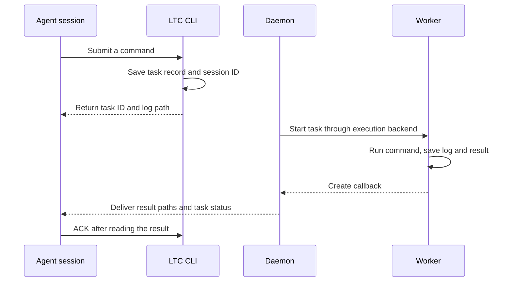

# Architecture

Consider the quickstart task: an Agent submits a Python command, LTC saves its execution details, runs it in the background, and returns the result to the same conversation.

## How a task runs

1. The Agent calls `ltc run`. LTC records the command, working directory, environment, and session ID, then assigns a task ID.
2. The background coordinator, or Daemon, reads the task record and asks the execution backend to start it.
3. A Worker runs the command and writes standard output and standard error to a log.
4. When the command exits, the Worker saves its exit code and result and creates a callback.
5. The Daemon delivers the callback to the original session. The Agent reads the artifacts, runs `ltc ack`, and decides what to do next.

## Component responsibilities

| Component | Responsibility |
| --- | --- |
| CLI | Accept `run`, `agent`, and `done` commands; save task and callback records |
| Daemon | Coordinate startup, recovery, and callback delivery |
| Execution backend | Use operating-system process management to host Workers |
| Worker | Run the user's command; record logs, exit code, and result |
| Agent adapter | Identify sessions and construct child-agent and session-resume commands |
| Storage | Retain tasks, results, callbacks, and ACK records for inspection and recovery |

Linux uses systemd user services, macOS uses launchd, and Windows uses Task Scheduler and Job Objects. Linux and macOS also offer a GNU screen backend. Each task records the selected backend at submission.

With a native backend, the coordinator and tasks have their own system service owners. After a coordinator restart, it reads existing task records, checks processes and results, and continues handling callbacks.

## Three entry points

`ltc run` starts with a command that a Worker executes. `ltc agent` gives instructions to a newly started Agent and saves its answer. Both share the task records, execution backends, and callback flow.

`ltc done` handles work already running elsewhere. For example, a Slurm job reports its exit code at the end of a script, and LTC delivers that job's result to a specified conversation.

## Finding results

By default, task files live in `~/.ltc/tasks/<task-id>/`. `attempt-1.log` contains command output, and `result.json` records the execution result. The submission output and callback include their paths.

A callback ACK records that the Agent has received and checked the result. Use a [goal plan](guides/goals.md) to track a larger workflow, such as training, evaluation, and report generation.

To extend an execution backend or Agent adapter, see [module responsibilities](https://github.com/lz59970062/long-task-wakeup/blob/main/docs/architecture.md#responsibilities).
