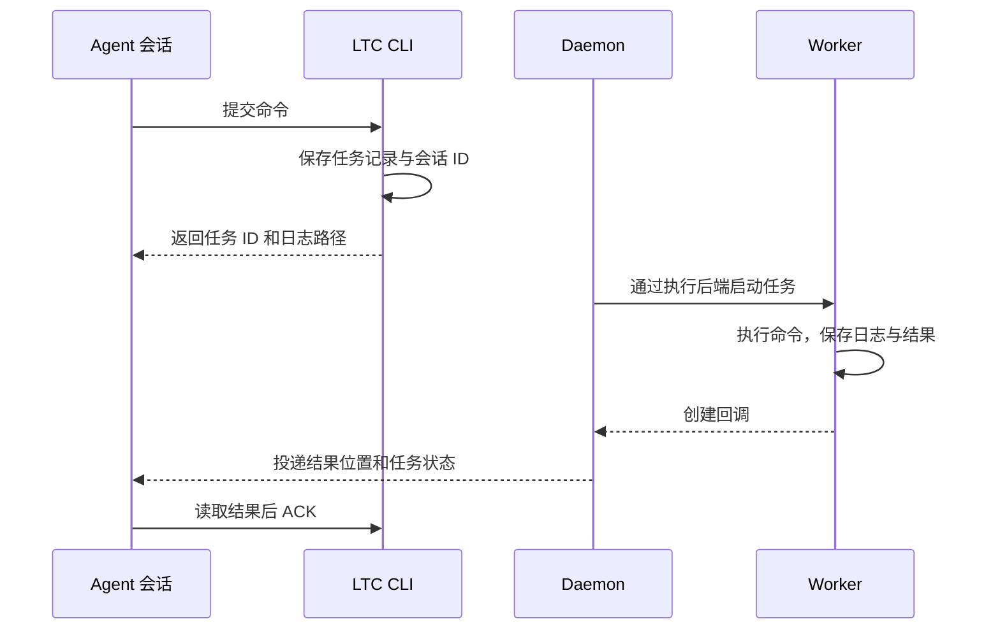

# 架构概览

以快速开始中的任务为例：Agent 提交一个 Python 命令，LTC 保存它的执行信息，在后台运行它，再把结果送回同一个会话。

## 一次任务如何执行

1. Agent 调用 `ltc run`。LTC 记录命令、工作目录、环境和会话 ID，生成任务 ID。
2. 后台协调器（Daemon）读取任务记录，交给执行后端启动。
3. Worker 执行命令，把标准输出和错误输出写入日志。
4. 命令退出后，Worker 保存退出码和结果，创建回调。
5. Daemon 将回调送回原会话。Agent 读取产物，执行 `ltc ack`，再决定下一步工作。

## 各组件负责什么

| 组件 | 工作 |
| --- | --- |
| CLI | 接收 `run`、`agent`、`done` 等命令，保存任务和回调记录 |
| Daemon | 协调任务启动，处理恢复，投递回调 |
| 执行后端 | 使用操作系统的进程管理机制托管 Worker |
| Worker | 执行用户命令，记录日志、退出码和结果 |
| Agent 适配器 | 识别会话，构造子 Agent 启动命令和原会话恢复命令 |
| 存储 | 保存任务、结果、回调和 ACK，供后续查询与恢复 |

Linux 使用 systemd 用户服务，macOS 使用 launchd，Windows 使用计划任务和 Job Object。Linux 和 macOS 也可以使用 GNU screen 后端。每个任务在提交时记录所选后端。

使用原生后端时，协调器和任务由各自的系统服务托管。协调器重启后，会读取已有任务记录，核对进程和结果，接着处理回调。

## 三个入口如何配合

`ltc run` 从一个命令开始，Worker 负责运行它。`ltc agent` 把任务描述交给一个新启动的 Agent，并保存它的回答。这两种入口共用任务记录、执行后端和回调流程。

`ltc done` 用于已经在其他环境中运行的任务。例如，一个 Slurm 作业在脚本结束处报告退出码，LTC 随后把这次运行的结果交回指定会话。

## 到哪里找结果

默认情况下，任务文件保存在 `~/.ltc/tasks/<task-id>/`。`attempt-1.log` 记录命令输出，`result.json` 记录执行结果；提交命令和回调都会给出对应路径。

回调 ACK 记录 Agent 已经收到并检查了这次结果。需要跟踪“训练、评估、生成报告”这样的完整流程时，可以建立[目标计划](guides/goals.md)，逐项记录各阶段进度。

扩展执行后端或 Agent 适配器时，参阅[模块职责](https://github.com/lz59970062/long-task-wakeup/blob/main/docs/architecture.md#responsibilities)。
